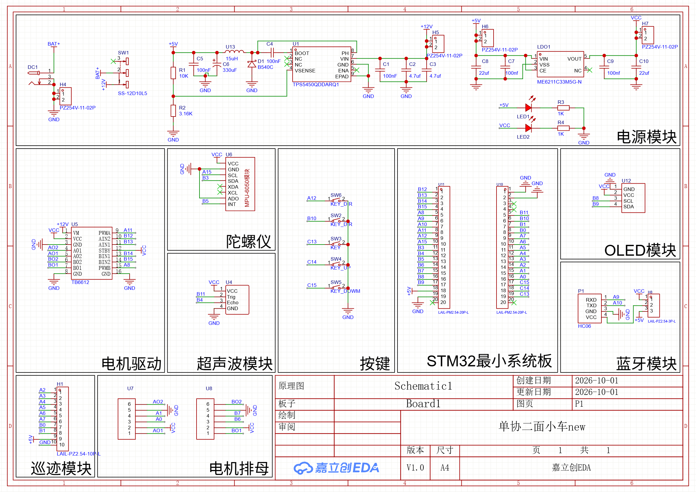

# SmartCar-STM32 智能循迹小车

基于 **STM32F103C8T6** 的两轮差速智能小车完整方案：小车端固件 + 自制蓝牙遥控器固件 + ESP32 蓝牙手柄接收器 + 电脑端测试脚本，全部使用 PlatformIO 构建，无需 Keil 授权。

**功能特性：**

- **8 路灰度循迹**：位置式 PD 转向 + 弯道状态机，直角弯识别与自动转弯，直道可全速冲刺
- **MPU6050 航向保持**：陀螺积分航向，直线纠偏、指定角度转向（0~360°），带零偏开机校准
- **编码器里程计**：轮速 PI 闭环 + 双轮同步，指定距离行驶、指定半径/角度转弯
- **HC-SR04 超声波**：定时器中断测脉宽（非阻塞），支持物体测距（中位数 + 安装补偿标定）、物体计数
- **蓝牙遥控**：HC-06 从机 + 自制 HC-05 主机遥控器，`AA 55` 帧协议 + XOR 校验，坏帧容错、失联自动刹车
- **游戏手柄遥控**：ESP32 + Bluepad32 蓝牙手柄接收器，Switch/PS/Xbox/8BitDo 手柄直连小车，扳机油门 + 摇杆转向，见 `esp32/`
- **OLED 调试页**：中英文混排界面，各模式实时状态、参数在线标定、供电电压抓波形

## 仓库结构

| 目录 | 内容 |
| --- | --- |
| `car/` | 小车端固件（bluepill_f103c8）：8 路灰度循迹、MPU6050 航向、编码器里程计、超声波测距、OLED 调试页、HC-06 蓝牙遥控 |
| `remote/` | 遥控器端固件（另一块 STM32F103C8T6）：摇杆采样 + OLED 显示，通过蓝牙以 `AA 55` 协议帧控制小车 |
| `esp32/` | **ESP32 蓝牙手柄接收器**：基于 Bluepad32，蓝牙游戏手柄直连小车，输出与遥控器相同的 `AA 55` 协议帧 |
| `tests/host/` | 电脑端 Python 冒烟测试：车端各模式响应、蓝牙链路抓包 |
| `tests/bluetooth_link_firmware/` | 蓝牙链路验证固件（主机/从机互通测试用） |
| `tools/` | 调试辅助脚本 |

---

以下是车端固件的完整开发文档（硬件连接、七个模式、标定流程、踩过的坑）。

---

## 一、硬件连接

底板原理图：



| 外设 | 引脚 | 说明 |
| --- | --- | --- |
| OLED | **PB8**=SCL, **PB9**=SDA | I2C1 重映射，地址 0x3C |
| MPU6050 | **PA15**=SCL, **PB3**=SDA, PB5=INT | 软件 I2C，地址 0x68（ADO 接地） |
| 超声波 HC-SR04 | **PB11**=TRIG, **PB4**=ECHO | ECHO 用外部中断 + DWT 计时 |
| 蓝牙 HC-06 | **PA9**=TX, **PA10**=RX | USART1，模式四用它连 VOFA+ |
| 电机 A | PWM=**PA11**(TIM1_CH4), AIN1=PB13, AIN2=PB12 | 编码器 = **PB6/PB7**（TIM4） |
| 电机 B | PWM=**PA8**(TIM1_CH1), BIN1=PB14, BIN2=PB15 | 编码器 = **PA0/PA1**（TIM2） |
| TB6612 STBY | 板上直接接 3.3V | 常使能 |
| 按键 ×5 | PB10, PC13, PC14, PC15, PA12 | 低电平按下，用内部上拉 |
| 8 路循迹 | PA2 PA3 PA4 PA5 PA6 PA7 PB0 PB1 | 10P 座 1~8 脚，模块由 +5V 供电 |

### 板上有两条独立的 3.3V 路径（排查供电问题时必须知道）

```
路径① OLED 用：  12V → TPS5450(5V) → ME6211(3.3V) → VCC 网络 → OLED / 超声波 / MPU6050 / TB6612逻辑
路径② 核心板用： 12V → TPS5450(5V) → 核心板 5V 脚 → 核心板自带稳压器 → 核心板 3.3V → 蓝牙模块
```

**蓝牙模块挂在路径②（核心板的 3.3V），不在底板的 VCC 上。**

所以会出现这种典型现象：**插着 ST-Link 一切正常（ST-Link 的 3.3V 引脚直接给核心板供电），一拔线就全死** ✗ —— 这说明路径②没通，而不是"蓝牙模块坏了"。

排查顺序（电池供电、拔掉 ST-Link）：

| 测哪里 | 应该是 | 不对说明 |
| --- | --- | --- |
| OLED 是否亮 | 亮 | 12V 总电源没进来 |
| **H6(+) 对 H4(-)** | 5V | 12V→5V 这一级的问题（先看**拨动开关有没有打开**） |
| 核心板排针第 18 脚对 GND | 5V | 核心板没插牢 / 插座接触不良 |
| 核心板排针第 3 或 20 脚对 GND | 3.3V | 核心板稳压器问题 |
| 蓝牙插座 VCC 对 GND | 3.3V | 模块插座接触不良 |

**验收标准**：拔掉 ST-Link，只用 12V 上电，OLED 和蓝牙模块的 LED 都该亮。

### 跳线帽怎么插

**核心板（单片机）上的 BOOT 跳线：必须插，而且必须插在 0 那一侧。**

STM32 上电时按 BOOT0 的电平决定启动位置：`0` = 从用户 Flash 启动（运行固件），`1` = 进芯片出厂 bootloader（固件完全不执行），**悬空则电平不确定，可能随机进 bootloader**。所以 BOOT0 和 BOOT1 都要接 0（多数核心板上 BOOT1 已焊死接地，或和 BOOT0 共用一个跳线排，插在标 `0` 的一侧即可）。

> 用 ST-Link 下载不需要动这个跳线，只有串口 ISP 方式才要临时拨到 1。所以正常状态一直插在 0 就行。

**底板上的 4 个 2 针端子（H4~H7）不用插跳线帽**：它们两端是同一个网络，是电源引出端子，方便用杜邦线接出去用——

| 端子 | 引出的电源 |
| --- | --- |
| H4 | GND |
| H5 | +12V |
| H6 | **+5V**（想给超声波模块单独接 5V 就从这里引） |
| H7 | VCC（3.3V） |

### 供电：必须接 12V 外部电源（不是可选项）

底板上的 **VCC（3.3V）不是核心板给的**，它的来源是：

```
12V 输入 -> TPS5450(12V转5V) -> +5V -> ME6211(5V转3.3V) -> VCC
```

**OLED、MPU6050、超声波、TB6612 的逻辑供电全都挂在 VCC 上**。所以只插 ST-Link（或者只用 USB 给核心板供电），这些外设一个都不工作——OLED 不亮、MPU6050 认不到，而且 I2C 总线会被未上电的器件拉死（SDA 一直是低电平），固件每次刷屏都要等 50ms 超时，主循环会被拖到几乎停摆。

所有设备采用外部供电，不允许通过电脑供电——接线时把 12V 电源接上，上电顺序：先接 12V，再插下载器。

### 三个必须知道的硬件坑（代码里已经处理）

1. **PA15 / PB3 / PB4 是 JTAG 引脚**。复位后它们是 JTAG 的 JTDI/JTDO/NJTRST，不作处理的话 MPU6050 和超声波永远不工作。`main.c` 里调用 `__HAL_AFIO_REMAP_SWJ_NOJTAG()` 关掉 JTAG（保留 SWD，所以 ST-Link 仍然能下载调试）。
2. **MPU6050 只能用软件 I2C**。它挂在 PA15/PB3 上，而硬件 I2C1 的默认脚（PB6/PB7）给了编码器、重映射脚（PB8/PB9）给了 OLED，I2C2 的 PB10/PB11 给了按键和超声波——没有任何硬件 I2C 能到这两个脚。
3. **超声波模块电源接的是 3.3V**，而 HC-SR04 标称要 5V。如果现场测距不稳或测不到，把模块 VCC 改接到 +5V（Echo 输出 5V，PB4 是 FT 引脚能承受，Trig 3.3V 一般也能触发）。

---

## 二、按键功能

板子上 5 个按键排成一排，**丝印从左到右是：MODE、+、−、L/R、START/STOP**，固件就是按这个顺序分配的（已经和芯片里的实际配置核对过，完全一致）：

| 丝印 | 引脚 | 功能 |
| --- | --- | --- |
| **MODE**（最左） | PA12 | 短按：切换模式 1→2→…→7→1；**长按：进出调试页** |
| **+** | PB10 | 参数增加（短按一步；按住 1 秒后每 0.3 秒连加一次） |
| **−** | PC13 | 参数减少（短按一步；按住 1 秒后每 0.3 秒连减一次）。注意：这个脚和核心板的板载 LED 共用，按下时 LED 会亮，属正常现象 |
| **L/R** | PC14 | 模式二：切换左转/右转；模式四：长按切换蓝牙波特率 |
| **START/STOP**（最右） | PC15 | 启动 / 停止；**长按：重新校准陀螺零偏（车必须静止）** |

所有按键都是"按下 = 接地"（内部上拉），所以在面包板上调试时，**用一根杜邦线从 GND 碰一下对应引脚就相当于按一下**，不用电阻也不用开关。

> 如果要把某个功能换到别的键上，只改 `car/src/board.h` 里 `KEY_*` 那 5 行的引脚即可，不用动其它代码。

## 三、七个模式怎么操作

上电后自动进模式 1，OLED 显示当前模式和操作提示。测评时不需要重新烧录，全部靠按键切换。

### 模式一 方向保持与自动纠偏（8 分）
1. 按 K1 切到显示 `1 方向保持`
2. K5 启动 → 小车朝当前朝向直行，并一直保持这个航向
3. 用手把车推歪 / 转个方向 → 小车会自己转回原航向继续走
4. K5 停止

### 模式二 指定角度转向（8 分）
1. 切到 `2 指定角度转向`
2. **L/R 键选方向**（左/右），**+ / − 键加减角度**（0~360° 共 13 档，含 360°；每按一次 30°，360° 就是转满一圈）
3. OLED 上会显示 `方向右 90度`
4. K5 开始 → 原地转到指定角度后停住，屏幕显示"转向完成"和实际航向

### 模式三 里程计（12 分）
1. 切到 `3 里程计`
2. K2/K3 选里程（50/60/70/80/90/100 cm 循环）
3. K5 开始 → 走完指定里程停车，屏幕显示"已走 xx.x cm"

### 模式四 速度曲线（12 分）
1. 切到 `4 速度曲线`，K2/K3 调目标速度（10~120 cm/s）
2. 手机/电脑配对 HC-06 蓝牙（默认配对码 1234），在 VOFA+ 里打开它对应的那个串口，数据引擎选 **FireWater**
3. K5 开始 → VOFA+ 上出现两条曲线：目标速度、实际速度（20Hz 刷新）

**波特率对不上怎么办**：HC-06 出厂默认是 9600，很多人会改成 115200。这个固件默认 **115200**，如果 VOFA+ 一条数据都没有：
- 在模式四空闲状态**长按 K4**，可在 `115200` 和 `9600` 之间切换，OLED 上会显示当前波特率；
- 把 VOFA+ 的波特率设成和屏幕一致，就能收到数据了。

**串口是一直在发的**：一进模式四就会以 20Hz 发数据（没启动时目标速度是 0，VOFA+ 上是一条贴着 0 的平线）。这样不用按 K5 就能先确认蓝牙链路通不通；按 K5 之后两条线才动起来。

**在电脑上确认收到了数据**：

```
cd tools
python bt_capture.py            # 先列出电脑上的串口
python bt_capture.py COM9       # 打开接收, 自动试 115200 和 9600
```

会打印收到的每一行（格式 `目标速度,实际速度`）。收到数据说明链路没问题，再开 VOFA+ 看曲线。

**蓝牙串口是模式四专用的**（波特率切换也只在模式四里生效），不要接到别的用途上。

### 模式五 循线行驶（15 分）
1. 把车放在线上（8 路循迹模块压住黑线）
2. 切到 `5 循线行驶`，K2/K3 设圈数（1~5）
3. K5 开始 → 循迹跑完 N 圈后停车。屏幕显示"完成N圈 总xx秒"和"最慢xx秒"
   （**最慢的一圈**过了"单圈<20 秒"才算过；秒数在停车那一刻冻住，不会再往上涨）
4. **一圈是怎么判的**：不是"转过 4 个弯"就算一圈——从直道中间起跑时，第 4 个弯
   转完离起点还有一段路。判据是三个条件同时满足：
   **4 个弯都转完 + 推算位置回到起跑点附近(±22cm) + 航向和起跑时一致(±35°)**
   （用编码器里程 + 航向做航位推算；每跑完一圈把推算原点重置一次，误差不会越攒越大）
   参数在 `app.c` 顶部的 `LAP_GOAL_R_CM` / `LAP_GOAL_YAW_DEG` / `LAP_RETURN_MAX_CM`。
5. **兜底**：第 4 个弯之后走了 `LAP_RETURN_MAX_CM`(200cm) 还没回到起点 → **异常停车**，
   圈数不增加（以前这里直接算"跑完"，等于把多跑的一段当成成功）
6. **航向比较做了 ±180° 归一化**：陀螺航向是一直累加的，跑完一圈比起点大 360°，
   直接相减会被当成"方向不一致"；归一化后顺/逆时针都能正确判成"回到起跑方向"
7. **丢线分两种情况处理**（`app.c` 顶部的 `LOST_*`）：
   - 线在**正前方**断掉（丢线瞬间偏差很小）→ 地图上的 60cm 空白段，保持原航向直行
   - 线从**侧面**跑掉（丢线瞬间偏差 >0.45）→ 直角弯没跟上，减速并朝线消失的方向转着找回来
   - 两种情况超过 2.5 秒都找不到线 → 停车并提示"丢线停在第 N 圈"
8. 跑的时候屏幕第 3 行是已走里程，第 4 行是"本圈秒数 + 状态"（`循迹中` / `空白段直行` / `找线中`）

### 模式六 物体计数与测距（15 分）
1. 把车放线上，切到 `6 物体计数测距`
2. K5 开始 → 循迹一圈，同时超声波扫描轨道外侧
3. 跑完显示 `物体数: N` 和每个物体的距离；物体多于 6 个时用 K2/K3 翻页
4. **计数用"进入—跟踪—离开"状态机**（不再用"两个物体必须间隔 8cm"这种硬门槛）：
   - **进入**：确认有目标才计数一次（第一件不做任何间距要求）
   - **跟踪**：持续更新这个物体的最近距离，**短暂丢一两次回波不会解除状态**
   - **离开**：连续 `OBJ_LOST_MS`(250ms) 没目标，或者又走了 `OBJ_LOST_CM`(12cm) 还没见到，
     才算离开 —— 之后才允许识别下一个
   这样既不会把同一个物体切成两个，也不会漏掉挨得近的两个物体
5. "一圈"的判定和模式五完全一样（4 个弯 + 回到起点 + 兜底异常停车）

**关于距离是从哪算起的**：超声波测的是"**探头前端面到物体**"的距离（声波从探头面发出、打到物体再返回，代码里的 `÷58µs/cm` 已经包含了往返）。而题目要的是"**物体到轨道（黑线）的距离**"，两者差着"探头面到车中线"这一段横向距离。

所以 `app.c` 里有个补偿参数：

```c
#define OBJ_TRACK_OFFSET_CM  0.0f   /* 传感器面到轨道(黑线)的距离, 单位 cm */
```

装车后量一下探头前端面到车中线的横向距离填进去（比如车宽 16cm、探头贴外侧就是 8），显示出来的就直接是"物体到轨道的距离"了。

**怎么标定这个值**（不用尺子量探头位置，直接对着实物调）：
1. 长按 K1 进调试页，**短按 K5 切到第二屏**，屏幕会同时显示
   `超声波 xx cm`（原始值）和 `到轨道 xx cm`（加上补偿之后的值）；
2. 把硬纸板放在**离黑线已知距离**的地方（比如离轨道 20cm），
3. 改 `app.c` 的 `OBJ_TRACK_OFFSET_CM`，让第二行读数等于真实值即可。
   （第二屏也会显示当前的补偿值和已计物体数，方便边跑边看。）

**前提是探头朝侧面（垂直轨道方向）装**。如果探头是朝正前方的，那测到的距离含义会变成"沿轨道方向的距离"，这个补偿就不适用，需要相应改判定逻辑。

**测距校准（两个旋钮）**：`board.h` 里有两个参数，按现象区分该调哪个——

| 现象 | 说明 | 调哪个 |
| --- | --- | --- |
| 误差**和距离成正比**：1m 差 1.3cm、2m 差 2.7cm、20cm 差 0.3cm | 声速常数和室温不符（代码默认按 21°C 的 58µs/cm） | `SONAR_US_PER_CM`（30°C 填 57.2、20°C 填 58.2） |
| 误差**各距离都是同一个值**：20cm 和 2m 都差 2cm | 固定偏移（模块内部延时，或测量基准不同） | `SONAR_OFFSET_CM`（少 2cm 就填 2.0） |

校准方法：拿硬纸板放在已知距离处（尺子顶住两个圆柱探头的前端面量，因为测距零点就是探头前端面），看**调试页第二屏的"原始"那一行**（一位小数），
**读数比真实值多就填负数，少就填正数**（例：真值 20cm、读数 21cm → 填 `-1.0`），再换 20cm / 50cm / 1m 复核一遍。

> 当前 `SONAR_OFFSET_CM` 已经改成 **0.0**（之前是 +1.0，实测发现普遍多 1cm，所以把补偿去掉了）。

>
> 判定阈值 `OBJ_DETECT_CM = 32cm`（题目要求物体离轨道 ≤30cm，留了 2cm 余量）。同一物体最小间隔 8cm，防止重复计数。

---

### 模式七 蓝牙遥控（20 分）

1. 切到 `7 蓝牙遥控`，手机/电脑连上 HC-06（默认配对码 1234）
2. **K5 启动**（进入待遥控状态），然后发指令；**K5 随时可以停车**
3. 屏幕显示：已收/丢弃的帧数、当前动作、上一条指令距今多少毫秒
4. **断联自动刹车 + 自动恢复**：超过 `RC_TIMEOUT_MS`(500ms) 没收到有效指令 →
   刹车并显示"遥控断联 已刹车 / 等遥控器回连"。蓝牙模块断链会自己回连 (遥控器端
   HC-05 是主机)，遥控帧恢复**且摇杆回中**后 → **自动恢复驾驶，不用按 K5**。
   断联期间摇杆还推着的话继续刹车等待，防止恢复瞬间窜车。
5. **心跳**：车端每 200ms 往蓝牙发 1 字节 `0xA5`（所有模式都发）——
   遥控器用它点亮链路指示 / 判断要不要踢模块重连。

#### 通信协议（车端已实现，遥控器端按这个发就行）

定长 5 字节帧：

```
AA 55 CMD ARG XOR        XOR = AA ^ 55 ^ CMD ^ ARG
```

| 字节 | 含义 |
| --- | --- |
| 0-1 | 帧头 `AA 55`（用来从乱数据里重新对齐） |
| 2 | 命令：`01` 前进 / `02` 后退 / `03` 左转 / `04` 右转 / `05` 停止 |
| 3 | 参数 0~100（速度/转速档位，停止填 0） |
| 4 | 校验 = 前 4 字节异或 |

**校验不过或者命令未知的帧一律丢弃，绝不会拿去驱动电机**（屏幕上的"丢"计数就是它）。
速度换算：`ARG=100` → 前进 60cm/s、转向 120°/s。

##### 6 字节帧（遥控器项目用的就是这两个）

| 帧 | 格式 | 说明 |
| --- | --- | --- |
| 混控帧 | `AA 55 06 LIN ROT XOR` | LIN/ROT 带符号 -100~100；车端换算 lin×0.6cm/s、rot×1.2°/s，倒车时转向自动取反 |
| 坦克帧 | `AA 55 07 WL WR XOR` | 左右轮**直控**（一侧 0 = 该轮速度环钉在原地），不经混控——一侧停一侧转的大差速混控通道表达不了 |

遥控器端三模式：M1 坦克发 0x07 / M2 手柄、M3 单杆发 0x06，30Hz 发送；两轮都 0 或急停发 `06 00 00`。

#### 还没做遥控器之前，用电脑先验车端

```
cd tools
python rc_send.py COM9            # 交互: w前进 s后退 a左转 d右转 x停止 +/-调速 q退出
python rc_send.py COM9 --demo     # 自动演示一遍（前进→右转→前进→停止）
python rc_send.py COM9 --baud 115200   # 模块改过波特率就用这个
```

> 遥控器已完成：见本仓库 `remote/`（另一块蓝药丸 + HC-05 主机，三驾驶模式 + 力度档位 +
> 蓝牙自配对/自动回连）。上面的电脑发送只作为调试备用手段。
>
> 也可以用蓝牙游戏手柄直接开车：见 `esp32/`（ESP32 + Bluepad32 手柄接收器，插在原 HC-06 插口上，
> 发送同样的 `AA 55 06` 协议帧）。

## 四、调试页（标定用，长按 K1 进入）

调试页有**两屏**，长按 K1 进入、**短按 K1 退出**、**短按 K5 换屏**。

第一屏（电机 / 陀螺 / 循迹）：

```
编码L+1234 R-1210     ← 左右轮编码器计数（按住 K2/K3 分别转左/右轮时看变化）
距25.6 陀12/0/-3      ← 超声波实时距离(cm, 一位小数, -- = 无回波) + 三轴陀螺原始读数(÷100)。
                        转动车身看哪个陀螺数字变, 变的那条轴就是实际的偏航轴
                        （模块平放=第三个, 立放=第一或第二个）
yaw12 gz45 轴2        ← 航向角 / 角速度 / 自动判断出的偏航轴(0=X 1=Y 2=Z)
线01011000 3.27V      ← 8 路循迹状态 / 实时供电电压(单片机自测)
```

> 模式六**待机时**（没按 K5 启动）第 3 行也会实时显示 `超声波 xx cm`，
> 摆物体、试探头的时候不用先让车跑起来。

第二屏（超声波测试 / 标定，都带一位小数）：

```
原始 25.6 cm   ← 未加任何补偿的单次值（标定 SONAR_SCALE / SONAR_OFFSET_CM 就看这行）
到轨 26.6 cm   ← 中位数 + 校准 + 安装补偿 = 最终报出的"物体到轨道"距离
补0.0 比1.00   ← 零点补偿 / 比例系数（改 board.h 后这里跟着变）
回1353 超12    ← 本次采样有效的次数 / 无回波次数
```

**超声波的数据在固件里分成四路，用途不同不要混**：

| 数据 | 来源 | 用在哪 |
| --- | --- | --- |
| 原始值 | `hcsr04_distance_raw_cm()` | 只用于标定（调试页"原始"那行），不含任何补偿 |
| 校准值 | 原始值 × `SONAR_SCALE` + `SONAR_OFFSET_CM` | 单次结果 |
| 计物值 | 最近 3 次的中位数（已校准） | **物体计数**用，不叠加显示平滑 |
| 显示值 | 计物值再叠一层轻平滑（跳变 > 3cm 直接跟随） | 只给屏幕看 |

测量间隔超过 `SONAR_STALE_MS`(400ms) 会把旧窗口清空，新样本不会把过期数据"复活"。
回波统计按**本次采样**是否有效统计，不看中位数结果。

**最后一行是排查测距问题的关键**：`回` 一直涨 = 探头在工作；`超` 一直涨 = 收不到回波
（先查 VCC/GND、接线和探头朝向，别怀疑代码）；如果 `原始` 老是显示 `--`，看这两个计数
哪个在涨就能判断是"没接好"还是"程序没跑"。

按键：

| 键 | 作用 |
| --- | --- |
| **K1 短按** | 退出调试页（**会自动停车**，不会带着电机输出退出） |
| **K2 / K3 按住** | 分别让左轮 / 右轮转起来（看电机转向、编码器计数和方向） |
| **K4 短按** | 蓝牙模块 AT 自检（结果临时显示在第一行；测出来之后波特率会自动同步给模式四） |
| **K4 长按** | 给蓝牙模块发 AT+RESET（让它复位重新广播） |
| **K5 短按** | 切换调试页的两屏 |
| **K5 长按** | 重新校准陀螺零偏（车要静止，**校准前会先停车**） |

> 蓝牙自检和陀螺校准都是阻塞操作（最长 1 秒），执行前会先停车；做完之后要**先把
> K2/K3 松开再按**才会恢复驱动电机，免得按着测试键做校准、手没松车就窜出去。

**供电电压那一项**是单片机用内部 1.20V 参考源自测出来的（±0.1V），用来判断"电池供电时 3.3V 有没有被拉垮"——切换供电方式时直接看这个数字就行。

### 抓一段供电电压的波形（查"电池供电时 3.3V 塌陷"用）

屏幕上只有一个瞬时值，看不出"是慢慢掉还是抖"、也看不出周期。固件里带了一个
**供电波形记录器**（`car/src/pwrlog.c`）：用 ADC 连续测内部参考源，把 VDD 随时间的变化
存进 RAM，再用 SWD 读出来。电脑这边一条命令就能跑完：

```
cd tools
python pwr_capture.py            # 2ms 一个点, 512 点 (约 1 秒)
python pwr_capture.py 10000      # 10ms 一个点 (约 5 秒, 看慢速抖动)
```

它会打印一段 ASCII 波形 + 最低/最高电压 + **芯片自带欠压检测器(PVD, 2.9V)的报警点数**
+ **复位标志**（记录期间芯片有没有真的被拉停过）。

**前提（否则测出来是假象）**：
1. ST-Link **只接 SWCLK / SWDIO / GND**，**3.3V 那根线必须拔掉**——插着的话是
   ST-Link 在给板子供电，整条"12V→5V→3.3V"链路被绕开，什么都测不出来。
2. 板子用电池供电，被测的负载（比如蓝牙模块）要插着。
3. 拔掉 3.3V 后如果 OpenOCD 报 `Target voltage: 0.000` 连不上，就在 ST-Link 的
   3.3V 线和板子 3.3V 之间**串一个 1kΩ 电阻**：这样它只传感电压、几乎不供电。

**想连 5V 和 12V 轨一起测**（直接定位是哪一段塌的）：在 PA0 接 `10kΩ+1kΩ` 分压测 12V、
PA1 接 `10kΩ+10kΩ` 分压测 5V（电阻另一端接地），然后：

```
python pwr_capture.py 2000 --aux
```

注意 PA0/PA1 装车后接的是编码器，只有面包板上空着的时候才能这么用。

---

## 五、装车后必须做的标定（按顺序做，10 分钟）

代码是照 PCB 写的，但下面这些量只有实车才能确定，**必须逐项确认，否则车不会正常跑**：

| 步骤 | 怎么做 | 不对的话改哪里 |
| --- | --- | --- |
| 1. 按键对应 | 按每个键，看 OLED 反应 | `board.h` 的 `KEY_*` |
| 2. 电机转向 | 调试页按住 K2，看左轮是不是**往前**转 | 反了就改 `MOTOR_A/B_OUT_REVERSE` |
| 3. 左右电机 | 确认 K2 转的是左轮（不是右轮） | 不对改 `MOTOR_A_IS_LEFT` |
| 4. 编码器方向 | 按住 K2 时 L 的计数应该是**正的** | 反了改 `ENCODER_A/B_REVERSE` |
| 5. 编码器距离 | 跑模式三的 100cm，用尺子量实际走了多少；**新值 = 旧值 × 程序显示 ÷ 实测**（显示 100、实际 120 → 系数要**减小**到 64.6×100/120=53.8） | `board.h` 的 `ENCODER_COUNTS_PER_CM`（默认 64.6） |
| 6. 陀螺方向 | 模式二用手转 90° 试试：右转时 yaw 应该**变大** | 开机时用加速度计自动判断偏航轴和符号（模块平放/立放都行），反了就把模块转 180° 装 |
| 7. 陀螺漂移 | 静止 1 分钟看 yaw 变化，超过 ±5° 就长按 K5 重新校准 | 正常现象，MPU6050 没有磁力计 |
| 8. 循迹极性 | 调试页把车放在黑线上，看对应位是不是 **1** | 反了改 `LINE_ACTIVE_LEVEL` |
| 9. 循迹顺序 | 车头偏左时，`线` 那行应该是**左边**的位为 1 | 反了改 `LINE_REVERSE_ORDER` |
| 10. 循迹 PID | 跑模式五，蛇形就减小 `LINE_KP`，出弯慢就加大 | `app.c` 顶部的 `LINE_KP/LINE_KD` |
| 11. 转向精度 | 模式二转 90°，量实际角度，差得多就调 `TURN_KP` | `app.c` |
| 12. 速度环 | 模式四看 VOFA+ 曲线：跟不上目标就加大 `SPD_KP/SPD_KFF` | `control.h` |
| 13. 超声波补偿 | 调试页第二屏（K5 换屏），纸板放在离黑线已知距离处，调 `OBJ_TRACK_OFFSET_CM` 让"到轨道"读数等于真实值 | `app.c` 的 `OBJ_TRACK_OFFSET_CM` |
| 14. 计圈判定 | **把车放在直道中间**起跑跑 1 圈：应该回到起点附近才停，不能在第 4 个弯刚转完就停 | 停早了/停晚了改 `LAP_GOAL_R_CM`（默认 22cm） |
| 15. 丢线找线 | 在直角弯和 60cm 空白段各试一次：空白段应该直行，直角弯冲出去应该转着找回来 | 空白段被当成弯道 → 加大 `LOST_ERR_MIN`；弯道冲出去不回头 → 减小它（`app.c`） |

所有可调参数都集中在两个地方：**`car/src/app.c` 顶部**（各模式的行为）和 **`car/src/control.h` + `car/src/board.h`**（速度环、机械参数）。

---

## 六、编译与烧录

```
cd car
pio run                   # 编译
pio run -t upload         # 用 ST-Link 下载
```

串口 ISP 用户编译后烧 `.pio\build\bluepill_f103c8\firmware.hex`。

改界面文字（加汉字）后要重新生成中文字库：

```
cd tools
python genfont_cn.py      # 会扫描 src/*.c 里字符串用到的所有汉字
```

---

## 七、代码结构（`car/` 下）

```
car/src/board.h      所有引脚和机械参数（改硬件相关的东西先看这里）
car/src/main.c       HAL 初始化: 时钟/GPIO/关JTAG/I2C1重映射/串口/TIM1 PWM/编码器
car/src/app.c        六个模式的状态机 + 按键 + OLED 界面  ← 调行为主要改这里
car/src/control.c    轮速 PI 闭环 + 里程统计（上层只给"前进速度+角速度"）
car/src/motor.c      TB6612 驱动 + 编码器读取
car/src/imu.c        MPU6050 陀螺积分航向 + 零偏校准
car/src/soft_i2c.c   软件 I2C（给 MPU6050 用）
car/src/hcsr04.c     超声波（外部中断测脉宽，不阻塞）
car/src/line.c       8 路循迹
car/src/keys.c       5 个按键（消抖 + 短按/长按/连按）
car/src/oled.c       OLED 驱动（带脏页刷新，中英文混排）
car/src/font_cn.h    16x16 汉字点阵（自动生成）
car/src/vofa.c       VOFA+ FireWater 协议输出
car/tools/genfont_cn.py  汉字字库生成脚本
```

控制周期 10ms（100Hz），界面刷新 60ms。所有闭环都在 10ms 周期里跑，OLED 只刷变化的页，不会拖慢控制。

---

## 八、调试过程中修掉的问题

| 现象 | 原因 | 解决 |
| --- | --- | --- |
| 程序一上电就死，屏幕和传感器全都不工作 | `motor.c` 里编码器定时器句柄忘了赋 `Instance`，导致 TIM 时钟没打开、HAL 往地址 0 写寄存器触发 HardFault | 补上 `htim4.Instance = TIM4;` / `htim2.Instance = TIM2;` |
| 模式四一个字节都发不出去 | `HAL_UART_Transmit_IT` 靠中断发送，但 MSP 里没使能 USART1 的 NVIC，也没写 `USART1_IRQHandler` | 补上中断使能和中断服务函数 |
| 屏幕文字重叠、像卡住 | `OLED_ClearLine()` 只清了一页(8 像素)，而一行文字 16 像素跨两页，下半截留着旧内容 | 改成清两页 |
| OLED 突然完全不响应、I2C 一直超时 | 复位打断了 I2C 传输，从机卡在半字节状态拽住 SDA 不放 | 开机做 I2C 总线恢复（9 个时钟脉冲 + STOP） |
| 速度显示乱跳 | 编码器没接时引脚悬空拾取噪声，数出假脉冲 | 编码器输入脚改成上拉 |
| 按一下按键加好几格 | 按键接触抖动被记成多次按下 | 积分滤波消抖 + 350ms 按下间隔锁定 + 步进固定 30° |
| 角度选不到 360° | 范围写成了 `% 360`，加到 330 就绕回 0 | 改成 0~360 共 13 档 |
| 陀螺仪认不到 | 初始化里死卡 `WHO_AM_I == 0x68`，而很多模块实际是 MPU6500 兼容芯片 | 地址自动探测(0x68/0x69) + 不再卡 WHO_AM_I，只记录型号 |
| 按住调试页的测试键、再短按 K1 退出，轮子还在转 | 调试页是直接给 PWM 的，退出时没有任何地方清这个输出 | 退出调试页/进出调试页/做阻塞操作前统一 `control_stop()` |
| 陀螺仪跑着跑着掉线，车还按旧航向继续跑 | 运行中读失败只 `return`，`imu_ok()` 一直返回真，航向就停在最后一次的值上 | 记录最近一次成功读取的时间 + 连续失败计数（`imu_alive()`），掉线立即停车并霸屏报故障；初始化每个写寄存器都检查返回值 |
| 模式六起步 8cm 内的物体漏计 | 第一件物体也被要求"已行驶超过 8cm"才允许计入 | 间距抑制只对第二件及以后的物体生效 |
| 从直道中间起跑，第 4 个弯转完就停车（没回到起点） | 只按"4 个弯 = 一圈"计数 | 改成 **4 个弯 + 航位推算回到起点附近 + 航向一致** 才判一圈（`lap_reached()`） |
| 蓝牙自检之后模式四收不到数据 | 自检依次试 9600/115200，结束时串口停在最后试的那个波特率上，和界面显示的变量不一致 | 自检确认成功后把波特率同步给 `bt_baud`，没测出来就恢复原设定 |
| 车停着被搬动后，下一次启动会窜一下 | 停车后 `control_update()` 仍在跑速度环 PI，搬动车的编码器脉冲全灌进积分项 | 停车状态直接跳过 PI（里程/速度显示照常），启动前再 `control_reset()` 清一次 |
| 循线完成后秒数一直往上涨 | 显示用的是 `HAL_GetTick() - run_start_ms`，停车后时间还在走 | 停车时记下 `run_end_ms` 冻住计时，并记录每圈耗时，显示最慢的一圈 |
| 跑满一圈后被判成"方向不一致" | 陀螺航向一直累加，跑完一圈比起点大 360°，直接相减得到 360° | 航向差归一化到 ±180°（`ang_diff()`），360° 变成 0° |
| 从直道中间起跑、多跑了一大段反而算"跑完" | 兜底判据直接返回"跑完" | 改成返回 `LAP_FAIL` → **异常停车，圈数不增加** |
| 同一个物体被算两次 / 挨得近的两个物体漏计 | "无回波立刻解除物体状态" + "必须间隔 8cm" | 改成**进入—跟踪—离开**状态机：短暂丢回波保持状态，离开要看时间和里程 |
| 诊断操作做完后车可能自己继续走 | 自检/复位只调了 `control_stop()`，没清 `running` | 统一 `diag_begin()/diag_end()`：停车清状态 → 做诊断 → 恢复串口和计时基准 → **保持停车** |
| 供电记录的最高/最低电压反了 | `hi_mv` 用了最大原始读数算（原始读数越大电压越低） | 两行互换；ADC 采样失败（读到 0）单独计数，不参与最值 |
| 调试页的"原始距离"其实带了补偿 | 调的是 `hcsr04_distance_cm()`（含 SCALE/OFFSET） | 改用 `hcsr04_distance_raw_cm()`，标定才准 |

## 九、还没做的 / 需要知道的

- **模式七：车端接收/校验/断联停车/按键停车均已实现，遥控器端固件见本仓库 `remote/`**
  （另一块 STM32F103C8T6 + HC-05 主机 + 摇杆 + OLED，三驾驶模式 + 力度档位 + 蓝牙自配对/自动回连）。
  没带遥控器时可以先用 `tools/rc_send.py` 从电脑发指令验车端。
- **模式五的计圈方式**是"陀螺识别直角弯（4 个弯）+ 航位推算回到起点"。它默认场地是
  矩形/正方形闭环；如果场地是三角形、或者弯道不是 90°，`LINE_CORNER_DEG` 和"4 个弯"
  这两个前提就要改（`app.c` 的 `corner_update()` / `lap_check()`）。
- **丢线找线的判据（`LOST_ERR_MIN`）需要在地图上验证**：现在的依据是"线从侧面消失
  还是正前方消失"。如果地图的 60cm 空白段正好接在直角弯后面，这个判据可能不够，
  要到现场跑一次看状态行的显示（`循迹中`/`空白段直行`/`找线中`）再调。
- **MPU6050 没有磁力计**，航向靠陀螺积分，会缓慢漂移（典型 1~2°/分钟）。测评前长按 K5 重新校准一次即可。
- **模式六的超声波朝向**决定了测的是不是"物体到轨道的距离"。如果模块是朝正前方的，测到的距离含义会变成沿轨道方向的距离，需要相应调整判定逻辑。
- 代码经过编译验证（arm-none-eabi-gcc，零警告）和引脚与 PCB 网表的一致性交叉验证，但**没有在实车上跑过**——上面第五节的标定是不可跳过的一步。
